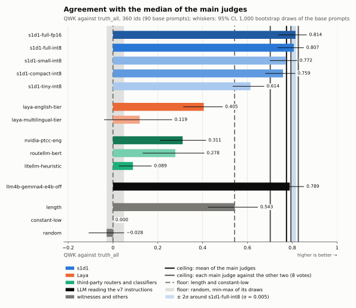

# s1d1-alliance

The free community instance of the s1d1 prompt router, at <https://s1d1.qoo.gy>.

**This repository is everything that runs s1d1.qoo.gy:** the landing page, the `api` and `ingest` Workers, the
anonymiser, the Terraform for Cloudflare, Google Cloud and Hetzner Cloud, and the Compose file of a community node.
Nothing runs there that is not in this repository, and nothing in this repository is a secret.

**Status:** live since 2026-10-25 at <https://s1d1.qoo.gy> (see [docs/operations.md](docs/operations.md) to run your own).

**Licence:** Apache-2.0 (see [LICENSE](LICENSE) and [NOTICE](NOTICE)); the legal pages of the site are not covered. See [Licences of the s1d1 projects](#licences-of-the-s1d1-projects).

**How well the model routes:** [s1d1-bench](https://github.com/scombat/s1d1-bench), an open, replayable bench, scores
the model against the median of three local LLM judges on 360 prompts in four languages, next to a prompt-length witness,
the judges' own agreement and the two classifiers LiteLLM documents (its built-in heuristic and Laya). The instance
serves the `small` int8 variant. To try the model without sending anything anywhere, the
[in-browser demo](https://huggingface.co/spaces/scombat/s1d1-router-demo) runs it in your browser.

<p align="center"></p>

## The data path

```
                           s1d1.qoo.gy  (Cloudflare zone)
          ┌────────────────────────┼──────────────────────────────┐
          │ /                      │ /api/*                        │ /ingest
          ▼                        ▼                              ▼
     static landing           Worker "site"                  Worker "ingest"
     + /status.json           closed paths, 30 req/10 s      bounded batches,
                              and 1 000/h per client,        fail closed
                              cache by SHA-256,                    │
                              fail open                            │
                                   │ miss                          │
                                   ▼                               ▼
                           Cloudflare Tunnel              GCS "raw" (EU, 3 days)
                         ┌─────────┴─────────┐                     │
                         ▼                   ▼                     ▼ every 2 days, X at random
                  Hetzner: tantive     homelab: tantive    Cloud Run Job: GLiNER + regex
                         └──── captures ─────┘                     │
                               sent to /ingest                     ▼
                                                          R2 "clean" (EU, kept)
   other instances (when enabled) ── batches ──► /ingest
   direct senders (v1 format)     ── batches ──► /ingest
```

- The landing is static. `/status.json` says what runs; `/llms.txt` is the guide for agents.
- `/api/*` accepts a closed list of paths only. Anything else answers 404. It is limited to 30 requests per 10 s and 1 000 per
  hour per client, by the `site` Worker itself: a Durable Object counter (`workers/limiter`), not a zone rule. The
  client is named by an HMAC of its IP, which is never stored.
- Only the paths of the API leave the Cloudflare Tunnel; the nodes publish no port.
- A prompt lands in the raw bucket. Every 2 days a Cloud Run Job draws a bounded number of the waiting prompts at
  random, anonymises them and writes the clean copies to the clean bucket; the others are never stored. The cost is
  bounded per run, whatever the traffic. The raw copy is deleted after 3 days (4 at most, the deletion is
  asynchronous). The clean copy keeps no instance identifier, no IP address and no headers. The contract is in `contract/ingest-v1.md`.
- Each node pulls its own images by digest and checks their cosign signature before it starts them.

## Manual prerequisites

These are done by hand, once, by the maintainer. No secret is stored in this repository.

1. A **Cloudflare** account with the zone `qoo.gy`.
2. A **Google Cloud** project with billing enabled.
3. A **HCP Terraform** organisation, which runs the Terraform in this repository.
4. A **Hetzner Cloud** account and project (paid, about 6 EUR excluding VAT a month for the node), with its own billing.

Tokens, keys and `terraform.tfvars` are given to HCP Terraform or to the nodes, never committed.

## Secrets

- `gitleaks` runs as a pre-commit hook and in the CI `secrets` job of `.github/workflows/ci.yml`. It is the installed binary, version 8.30.1.
- Install the hook once with `uvx pre-commit install`. Check the whole tree with `uvx pre-commit run --all-files`.
- `.gitignore` keeps `*.tfvars`, `*.env` and `.terraform/` out of the repository, except the two node templates.

## Contents

- `contract/` the ingestion contract (v1) and its fixtures.
- `node/` the Compose file of a community node, its signed pull updates and its cloud-init.
- `.gitleaks.toml`, `.pre-commit-config.yaml`, `.editorconfig`, `.gitignore`.

## Licences of the s1d1 projects

| Project | Licence | Why |
|---|---|---|
| [s1d1-router](https://huggingface.co/scombat/s1d1-router) (the model) | Apache-2.0; the base model, mmBERT-base, is MIT | open weights, reusable anywhere |
| [s1d1-alliance](https://github.com/scombat/s1d1-alliance) (this repository) | Apache-2.0 | community infrastructure, made to be forked |
| [s1d1-tantive](https://github.com/scombat/s1d1-tantive) (the serving engine) | Business Source License 1.1, which becomes Apache-2.0 four years after each release | free for non-production use; production use by agreement while it funds the project |

Everything converges on Apache-2.0: the model and this repository today, the serving engine on each release's change
date.

